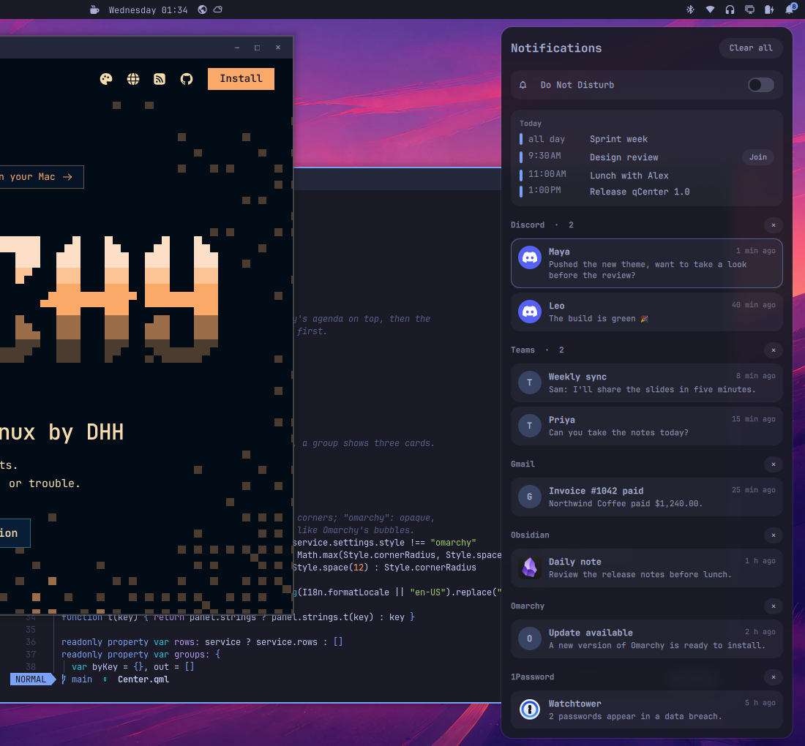
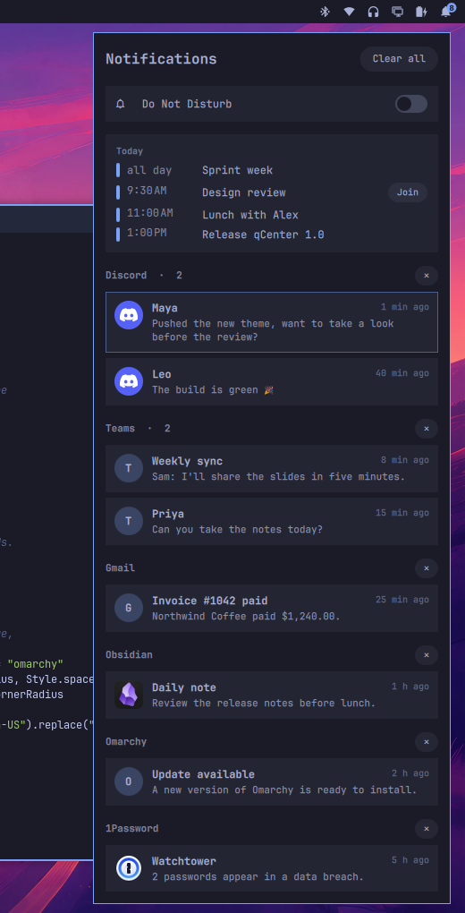
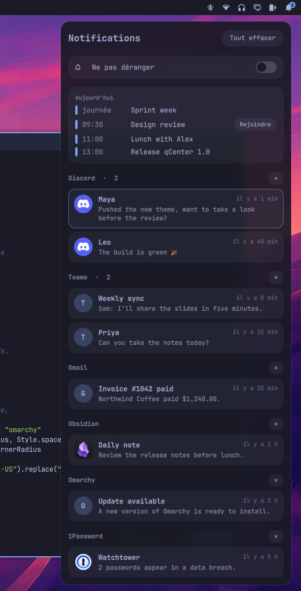

<p align="center">
  
</p>

<h1 align="center">qCenter</h1>

<p align="center">Un centre de notifications façon Mac pour <a href="https://omarchy.org">Omarchy</a>, aux couleurs de votre thème.</p>

<p align="center"><a href="README.md">English version</a></p>



**Vous venez de macOS ?** qCenter, c'est le centre de notifications, avec le calendrier de la
vue Aujourd'hui ; la cloche fait ce que fait un clic sur l'horloge du Mac. Sous Windows : le panneau
de notifications et son calendrier. Il va avec [qDock](https://github.com/quebecstudio-mods/omarchy-qdock), le Dock, et
[qExposé](https://github.com/quebecstudio-mods/omarchy-qexpose), Exposé et Mission Control.

- **Ce que vous avez manqué, au même endroit.** Les bulles d'Omarchy
  s'effacent après quelques secondes ; celles qui sont parties d'elles-mêmes,
  ou que Ne pas déranger a tenues à l'écart, attendent ici, groupées par app,
  les plus récentes d'abord. Les bulles encore à l'écran sont encadrées. Les notifications web sont distinguées par site :
  Teams, Gmail et Outlook ont chacun leur groupe, pas un seul « Chrome ».
- **Greffé sur les notifications d'Omarchy**, sans les remplacer : qCenter lit
  ce qu'Omarchy enregistre déjà. De son côté, il ne garde que ce que vous
  avez effacé, et l'agenda du jour avec les copies de vos calendriers, dans
  `~/.local/state/qcenter/`. Les bulles, les sons et les règles d'Omarchy
  restent tels quels.
- **Un clic pour y aller.** Une notification lance la commande qui
  l'accompagne, ou ramène la fenêtre de son app, ou ouvre son site.
- **Ne pas déranger**, un interrupteur en haut. Ce qu'il retient vous attend
  dans le centre.
- **L'agenda du jour** tiré de vos calendriers : Google, Outlook, iCloud,
  Fastmail ou tout lien ou fichier ICS, avec un bouton **Rejoindre** pour les
  appels Meet, Teams et Zoom.
- **Une cloche pour la barre**, avec le nombre en attente.
- **Deux styles.** Mac (coins arrondis, verre givré) ou Omarchy (coins du
  thème, opaque).
- **Anglais et français**, selon la langue d'Omarchy.

| Style Omarchy | En français |
| --- | --- |
|  |  |

## Installation

```bash
omarchy plugin add https://github.com/quebecstudio-mods/omarchy-qcenter --enable
```

La cloche se place à droite de la barre. Pour ouvrir le centre au clavier,
ajoutez un raccourci à `~/.config/hypr/bindings.lua` :

```lua
o.bind("SUPER + N", "Notification center", "omarchy-shell -q quebecstudio.qcenter toggle")
```

### Verre givré

En style Mac, le panneau est translucide. Pour le flou derrière, ajoutez cette
règle à `~/.config/hypr/hyprland.lua` :

```lua
hl.layer_rule({ match = { namespace = "^qcenter$" }, blur = true, ignore_alpha = 0.2 })
```

## Réglages

Dans l'entrée de qCenter, sous `plugins`, dans `~/.config/omarchy/shell.json` :

```json
{
  "id": "quebecstudio.qcenter",
  "style": "mac",
  "calendars": [
    { "name": "Travail", "color": "#7aa2f7", "url": "https://calendar.google.com/calendar/ical/…/basic.ics" },
    { "name": "Maison", "color": "#9ece6a", "url": "~/Calendriers/maison.ics" }
  ]
}
```

| Réglage | Valeurs | Par défaut |
| --- | --- | --- |
| `style` | `"mac"`, `"omarchy"` | `"mac"` |
| `calendars` | Une liste de `{ name, color, url }` : un lien `https://` ou `webcal://`, ou le chemin d'un fichier `.ics` | aucun |
| `agendaFile` | Le chemin d'un JSON d'agenda que vous tenez à jour vous-même (voir plus bas) ; remplace `calendars` | aucun |

Sans `calendars` ni `agendaFile`, pas de section agenda.

### Calendriers

Toutes les apps de calendrier publient un lien ICS privé : dans Google Agenda,
*Paramètres › votre agenda › Adresse secrète au format iCal* ; dans Outlook,
*Paramètres › Calendrier › Calendriers partagés › Publier un calendrier* ; dans
iCloud, partagez le calendrier comme calendrier public. qCenter télécharge
chaque lien au plus toutes les cinq minutes (toutes les dix en arrière-plan),
garde une copie pour quand vous êtes hors ligne, et gère les fuseaux horaires
et les événements répétés. Il ne demande que Python, fourni avec Omarchy.

Ces liens sont des secrets : qui en a un peut lire le calendrier. Ils restent
dans votre `shell.json`, qCenter ne les met jamais sur une ligne de commande, et
il ne les télécharge qu'en https : un lien `http://` est refusé.

### Votre propre fichier d'agenda

Si votre calendrier n'a pas de lien ICS, faites écrire ce JSON par n'importe
quel script et pointez `agendaFile` dessus ; qCenter le relit quand il change :

```json
{
  "events": [
    { "title": "Revue de design", "start": "2026-11-11T10:00:00-05:00", "end": "2026-11-11T11:00:00-05:00",
      "color": "#7aa2f7", "join": "https://meet.google.com/abc-defg-hij" },
    { "title": "Semaine de sprint", "start": "2026-11-11", "end": "2026-11-12", "allDay": true }
  ]
}
```

`start` et `end` sont des dates ISO 8601, ou de simples dates pour les
événements d'une journée entière (`end` exclu). `color`, `join` (un lien
`https://`) et `allDay` sont facultatifs.

## Commandes

```bash
omarchy-shell -q quebecstudio.qcenter toggle
omarchy-shell -q quebecstudio.qcenter open
omarchy-shell -q quebecstudio.qcenter close
omarchy-shell quebecstudio.qcenter count        # notifications en attente
omarchy-shell -q quebecstudio.qcenter syncAgenda   # télécharger les calendriers maintenant
```

## Bon à savoir

- qCenter a besoin des notifications d'Omarchy, le plugin intégré
  `notifications`, activé comme il l'est par défaut : rien à désinstaller ni à
  désactiver avant. Si vous les avez remplacées par un autre démon de
  notifications (mako, swaync, dunst), qCenter n'a rien à lire.
- **✕** retire des notifications du centre ; une bulle encore à l'écran y reste
  jusqu'à ce qu'elle s'efface ou que vous la fermiez. **Tout effacer** ferme
  aussi toutes les bulles.
- Un clic sur la carte de la bulle la plus récente fait ce que fait un clic sur
  la bulle, action propre à l'app comprise.
- Omarchy garde son historique de notifications 24 heures, 100 au plus ;
  qCenter montre ce qu'il contient.
- qCenter lit les fichiers d'Omarchy dans `~/.local/state/omarchy/notifications/`.
  Si une future version d'Omarchy en change le format, le centre pourrait
  rester vide jusqu'à une mise à jour de qCenter.

## Fonctionne avec

- [qDock](https://github.com/quebecstudio-mods/omarchy-qdock), un dock façon Mac.
- [qExposé](https://github.com/quebecstudio-mods/omarchy-qexpose), Exposé et
  Alt+Tab avec aperçus.

## Licence

MIT © Québec Studio. Le routage vers les fenêtres est adapté du service de
notifications d'Omarchy (MIT), issu
d'[Omapager](https://github.com/omacom/omapager) de Neil Jagdish Patel.

macOS, Mission Control et Exposé sont des marques d'Apple Inc. Ce projet n'est ni affilié à Apple ni approuvé par Apple.
