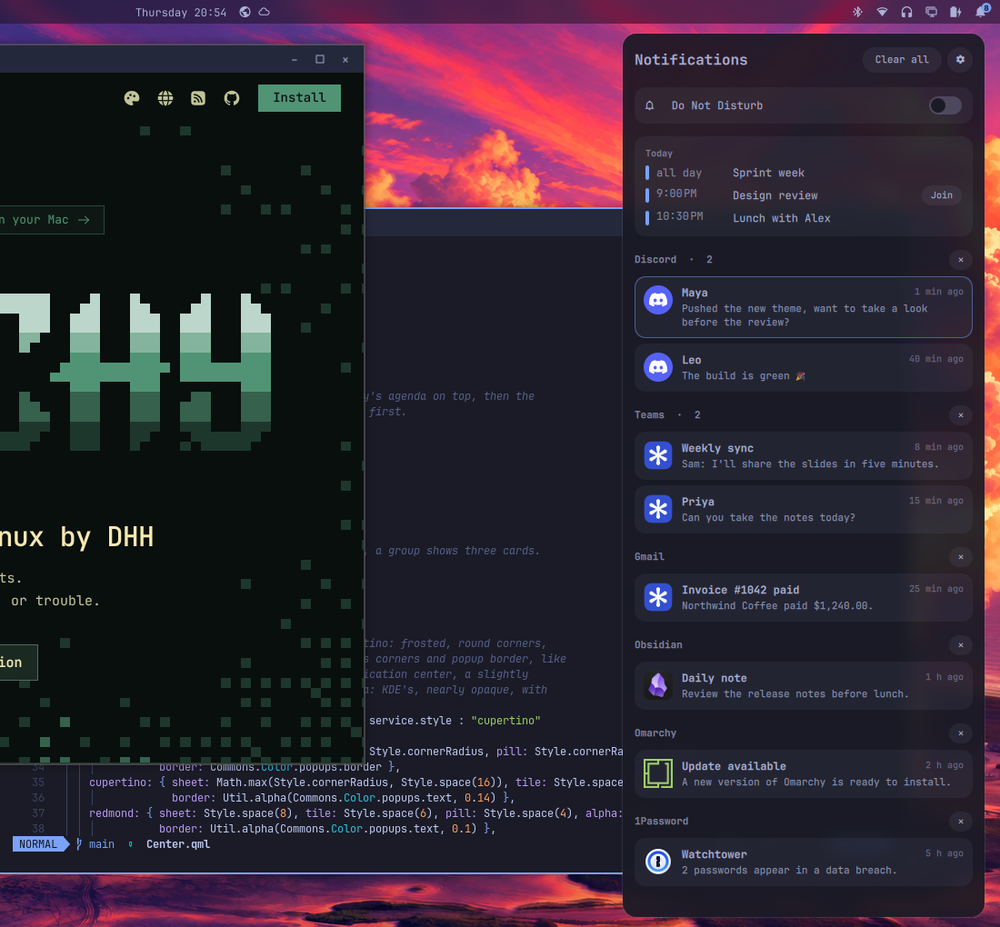
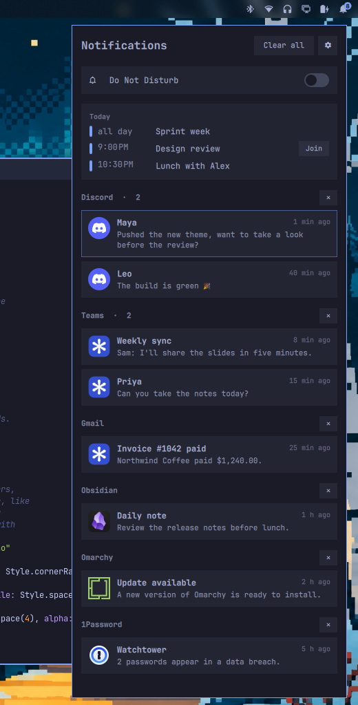
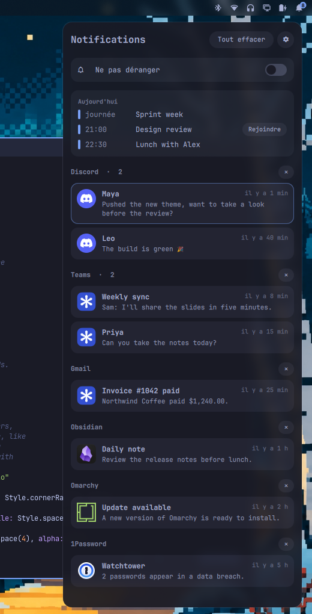
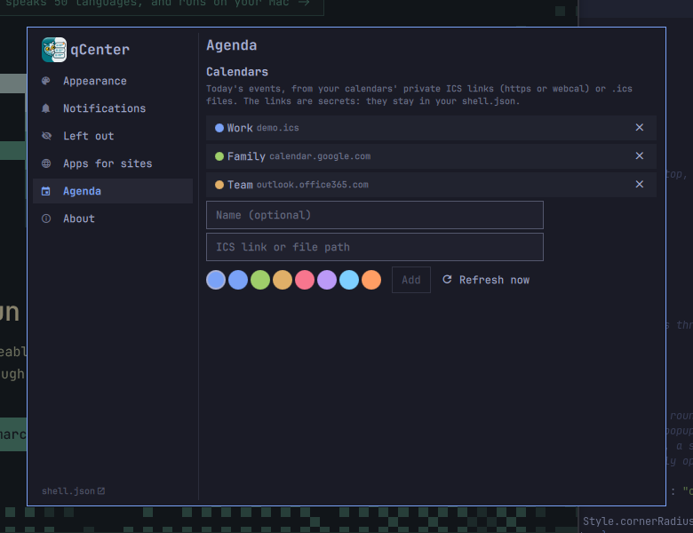

<p align="center">
  
</p>

<h1 align="center">qCenter</h1>

<p align="center">A Mac-style notification center for <a href="https://omarchy.org">Omarchy</a>, in your theme's colors.</p>

<p align="center"><a href="README.fr.md">Version française</a></p>



**Coming from macOS?** qCenter is the Notification Center, with the calendar of the Today
view; the bell does what clicking the clock does on a Mac. From Windows: the notification
panel with its calendar. It pairs with [qDock](https://github.com/quebecstudio-mods/omarchy-qdock), the Dock, and [qExposé](https://github.com/quebecstudio-mods/omarchy-qexpose),
Exposé and Mission Control.

- **What you missed, in one place.** Omarchy's bubbles fade after a few
  seconds; the ones that faded on their own, or that Do Not Disturb kept off
  the screen, wait here, grouped by app, newest first. Bubbles still on screen
  are outlined. Web notifications are told apart by
  site: Teams, Gmail and Outlook each get their own group, not one "Chrome".
- **Built on Omarchy's own notifications**, not in their place: qCenter reads
  what Omarchy already records. Of its own, it keeps only what you cleared,
  and today's agenda with copies of your calendars, in
  `~/.local/state/qcenter/`. Omarchy's bubbles, sounds and rules stay as they
  are.
- **Click to go there.** A notification opens the command it came with, or
  brings its app's window forward, or opens its site.
- **Do Not Disturb**, one switch at the top. Notifications it holds back are
  in the center when you look.
- **Today's agenda** from your calendars: Google, Outlook, iCloud, Fastmail or
  any ICS link or file, with a **Join** button for Meet, Teams and Zoom calls.
- **A bell for the bar**, with the number waiting.
- **Confirmations stay out.** A screenshot saved, a layout changed: Omarchy
  sends these at low urgency, and they show as bubbles but skip the center.
  Any app or site can be left out too.
- **A settings window**, drawn with Omarchy's own controls: the style, what the
  center keeps, the app each site opens, your calendars.
- **Four styles**, qDock's: Omarchy (your theme's corners, opaque), Cupertino
  (round corners, frosted glass), Redmond (like Windows' notification center)
  and Plasma (like KDE's).
- **English and French**, following Omarchy's language.

| Omarchy style | En français |
| --- | --- |
|  |  |

## Install

```bash
omarchy plugin add https://github.com/quebecstudio-mods/omarchy-qcenter --enable
```

Omarchy first shows a security notice and asks you to confirm (*Clone and add
this plugin?*); add `--yes` to skip the question in a script.

The bell lands on the right of the bar. To open the center from the keyboard,
add a binding to `~/.config/hypr/bindings.lua`:

```lua
o.bind("SUPER + N", "Notification center", "omarchy-shell -q quebecstudio.qcenter toggle")
```

### Frosted glass

In the Cupertino, Redmond and Plasma styles, the panel is translucent. For the blur behind it, add this
rule to `~/.config/hypr/hyprland.lua`:

```lua
hl.layer_rule({ match = { namespace = "^qcenter$" }, blur = true, ignore_alpha = 0.2 })
```

## Settings

qCenter has a settings window: click the gear at the top of the center, or
open **qCenter Settings** from the app launcher.



To find it in Omarchy's menu too, add this line to
`~/.config/omarchy/extensions/omarchy-menu.jsonc`:

```jsonc
"setup.qcenter": {"icon":"󰂚","label":"qCenter Settings","aliases":["qcenter","notifications"],"action":"omarchy-shell -q quebecstudio.qcenter settings"},
```

The launcher entry is in the plugin's `assets` folder:

```bash
cp ~/.config/omarchy/plugins/qcenter/assets/qcenter-settings.desktop ~/.local/share/applications/
cp ~/.config/omarchy/plugins/qcenter/assets/logo.png ~/.local/share/icons/hicolor/256x256/apps/qcenter.png
```

Every setting is kept in qCenter's entry under `plugins` in
`~/.config/omarchy/shell.json` (the **shell.json** link at the bottom of the
window opens it):

```json
{
  "id": "quebecstudio.qcenter",
  "style": "cupertino",
  "calendars": [
    { "name": "Work", "color": "#7aa2f7", "url": "https://calendar.google.com/calendar/ical/…/basic.ics" },
    { "name": "Home", "color": "#9ece6a", "url": "~/Calendars/home.ics" }
  ],
  "webApps": { "teams.microsoft.com": "Teams Work" }
}
```

| Setting | Values | Default |
| --- | --- | --- |
| `style` | `"omarchy"`, `"cupertino"`, `"redmond"`, `"plasma"` (`"mac"`, 1.0's name, still reads as `"cupertino"`) | `"cupertino"` |
| `lowUrgency` | `true` keeps low-urgency notifications (confirmations) in the center too | `false` |
| `hiddenApps` | Apps and sites left out of the center, by app name or site: `["omasnap", "app.slack.com"]`; `"omarchy"` stands for Omarchy's own messages | none |
| `calendars` | A list of `{ name, color, url }`: an `https://` or `webcal://` link, or the path of an `.ics` file | none |
| `agendaFile` | The path of an agenda JSON you keep up to date yourself (see below); replaces `calendars` | none |
| `webApps` | The app to open for a site's notifications, by site: `{ "site": "app" }`, the app by its name in the launcher or its `.desktop` file (see below) | none |

Without `calendars` or `agendaFile`, there is no agenda section.

### Clicking a notification

A notification whose bubble is still on screen is clicked through Omarchy, so
the app that sent it opens it, a Teams message on its conversation. Once the
bubble is gone, qCenter brings the sender's window forward. If a website sent it
and no window of it is open, qCenter opens the web app you installed for that
site rather than the browser, and the browser when there is none.

With several apps for one site (Teams under two browser profiles, say), or to
send a site to a native app, name the app in `webApps`:

```json
"webApps": {
  "teams.microsoft.com": "Teams Work",
  "app.slack.com": "Slack"
}
```

Without it, qCenter takes the first of the site's web apps by name.

### Calendars

Every calendar app can publish a private ICS link: in Google Calendar,
*Settings › your calendar › Secret address in iCal format*; in Outlook,
*Settings › Calendar › Shared calendars › Publish a calendar*; in iCloud, share
the calendar as a public calendar. qCenter fetches each link at most every
five minutes (every ten in the background), keeps a copy for when you are
offline, and handles time zones and recurring events. It needs only Python,
which Omarchy ships.

The links are secrets: anyone who has one can read the calendar. They stay in
your `shell.json`, qCenter never puts them on a command line, and it fetches
them only over https: a plain `http://` link is refused.

### Your own agenda file

If your calendar has no ICS link, have any script write this JSON and point
`agendaFile` to it; qCenter reloads it when it changes:

```json
{
  "events": [
    { "title": "Design review", "start": "2026-11-11T10:00:00-05:00", "end": "2026-11-11T11:00:00-05:00",
      "color": "#7aa2f7", "join": "https://meet.google.com/abc-defg-hij" },
    { "title": "Sprint week", "start": "2026-11-11", "end": "2026-11-12", "allDay": true }
  ]
}
```

`start` and `end` are ISO 8601 dates, or plain dates for all-day events (`end`
excluded). `color`, `join` (an `https://` link) and `allDay` are optional.

## Commands

```bash
omarchy-shell -q quebecstudio.qcenter toggle
omarchy-shell -q quebecstudio.qcenter open
omarchy-shell -q quebecstudio.qcenter close
omarchy-shell quebecstudio.qcenter count        # notifications waiting
omarchy-shell -q quebecstudio.qcenter syncAgenda   # fetch the calendars now
omarchy-shell -q quebecstudio.qcenter settings     # toggle the settings window
omarchy-shell -q quebecstudio.qcenter settingsAt agenda   # on a section: appearance, notifications, hidden, sites, agenda, about
```

## Good to know

- qCenter needs Omarchy's own notifications, the built-in `notifications`
  plugin, enabled as it is by default: nothing to uninstall or turn off
  first. If you replaced them with another notification daemon (mako, swaync,
  dunst), qCenter has nothing to read.
- **✕** removes notifications from the center; a bubble still on screen stays
  until it fades or you close it. **Clear all** also closes every bubble.
- Clicking the newest bubble's card does what clicking the bubble does,
  including the app's own action.
- Omarchy keeps its notification history for 24 hours, 100 entries at most;
  qCenter shows what is in it.
- qCenter reads Omarchy's files in `~/.local/state/omarchy/notifications/`. If
  a future Omarchy changes their format, the center may come up empty until
  qCenter catches up.

## Works with

- [qDock](https://github.com/quebecstudio-mods/omarchy-qdock), a Mac-style dock.
- [qExposé](https://github.com/quebecstudio-mods/omarchy-qexpose), Exposé and
  Alt+Tab with previews.

## License

MIT © Québec Studio. Window routing adapted from Omarchy's notification service (MIT), which
began as [Omapager](https://github.com/omacom/omapager) by Neil Jagdish Patel.

macOS, Mission Control and Exposé are trademarks of Apple Inc.; Windows is a trademark of Microsoft Corporation; KDE and Plasma are trademarks of KDE e.V. This project is not affiliated with or endorsed by any of them.
